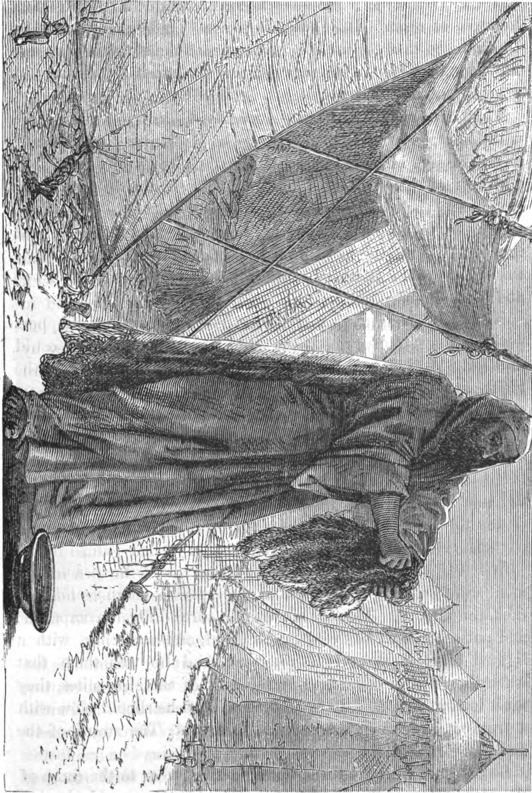

안녕하세요. dev.log입니다.

기드온은 하나님의 약속을 듣고도 거듭 확인을 구했던 사람입니다. 구약성경 사사기 6~8장에 등장하는 그는 이스라엘에 왕이 없던 시대의 ‘사사’였습니다. 사사는 위기에 처한 백성을 이끌고 구해 내던 지도자를 말합니다.

## 1. 함께하신다면 왜 이런 일이

당시 미디안과 그 동맹 세력은 이스라엘의 수확물을 망가뜨리고 가축을 빼앗았습니다. 기드온도 들키지 않으려고 포도주 틀에서 밀을 타작하고 있었습니다. 타작은 곡식에서 낟알을 떼어 내는 일이고, 포도주 틀은 포도즙을 짜는 시설입니다. 곡식을 다루는 곳이 아닌 다른 장소에서 먹을 것을 마련하던 셈입니다.

그때 하나님의 말씀을 전하는 천사가 찾아와 기드온을 용사라고 부르며 하나님이 함께하신다고 말합니다. 기드온은 그 말에 질문을 던집니다.

> “여호와께서 우리와 함께 계시다면, 왜 이토록 많은 괴로움을 겪어야 합니까?”
> — 사사기 6:13 일부, 쉬운성경

기드온은 조상들에게 하나님이 이스라엘을 이집트에서 구해 내셨다는 이야기를 들었습니다. 그런데 지금은 먹을 것조차 지키지 못하고 있었습니다. 그는 하나님이 함께하신다면 왜 이런 고통을 겪어야 하는지 묻고 있었습니다.

하나님은 그에게 이스라엘을 구하라고 하십니다. 기드온은 자기 집안도 약하고 자신도 보잘것없는데 어떻게 하겠느냐고 되묻습니다. 함께하겠다는 약속을 듣고도 확인할 표징을 요청합니다. 그가 바위 위에 놓은 음식에 천사가 지팡이를 대자, 바위에서 불이 나와 음식을 태웁니다.

본문: [사사기 6:1~24 · 쉬운성경](https://www.godpia.com/read/reading.asp?ver=easy&vol=jdg&chap=6)

페르디난트 볼, 「기드온과 천사」, 약 1640년. 후대의 성경 장면 묘사, 퍼블릭 도메인. [작품 출처](https://commons.wikimedia.org/wiki/File:Bol_-_Gideon_and_the_Angel.JPG)

## 2. 두려워서 밤에 움직였다

전투에 나가기 전, 하나님은 기드온에게 아버지의 바알 제단과 아세라 목상을 없애라고 하십니다. 바알과 아세라는 당시 사람들이 섬기던 다른 신들이었고, 제단은 신에게 제물을 바치는 곳이었습니다. 하나님은 자신을 위한 제단을 새로 세우라고 하십니다. 그의 집안에도 하나님이 아닌 다른 신을 섬기는 자리가 있었던 것입니다.

기드온은 가족과 마을 사람들의 반발이 두려워 밤에 나서서 명령받은 일을 실행합니다. 다음 날 사람들이 그를 죽이겠다고 나서자 아버지가 막아섭니다.

본문: [사사기 6:25~32 · 쉬운성경](https://www.godpia.com/read/reading.asp?ver=easy&vol=jdg&chap=6)

## 3. 양털로 다시 확인하다

미디안의 동맹군이 모이자 기드온도 함께 싸울 사람들을 부릅니다. 전투를 앞두고 그는 자신을 통해 이스라엘을 구하시겠다는 약속을 다시 확인하고 싶어 합니다.

그는 타작마당에 양털을 놓고, 양털에만 이슬이 내리고 주변 땅은 마르게 해 달라고 요청합니다. 그대로 이루어지자, 이번에는 반대로 양털만 마르고 땅에 이슬이 있게 해 달라고 부탁합니다. 하나님은 두 번째 요청에도 응하십니다.

기드온은 이미 받은 약속을 거듭 확인하고 있었습니다.

본문: [사사기 6:33~40 · 쉬운성경](https://www.godpia.com/read/reading.asp?ver=easy&vol=jdg&chap=6)

양털을 짜는 기드온, 1873년. 작가 미상의 후대 삽화, 퍼블릭 도메인. [작품 출처](https://commons.wikimedia.org/wiki/File:Gideon_wringing_the_fleece.jpg)

## 4. 300명과 적진에서 들은 말

모인 군사는 3만 2천 명이었지만, 하나님은 군사가 너무 많다고 하십니다. 두려워하는 사람들이 돌아가자 1만 명이 남고, 물가에서 물 마시는 방식에 따라 다시 나눈 뒤에는 300명만 남습니다. 이스라엘이 자기 힘으로 구원받았다고 자랑하지 못하게 하려는 것이었습니다.

그날 밤 하나님은 여전히 두렵다면 종과 함께 적진에 내려가 보라고 하십니다. 기드온은 그곳에서 한 군인의 꿈 이야기를 듣습니다. 보리떡이 굴러와 장막을 무너뜨렸다는 꿈이었습니다. 다른 군인은 이를 하나님이 미디안을 기드온에게 넘겨주실 징조로 풀이합니다.

그 말을 들은 기드온은 이렇게 반응합니다.

> “하나님께 감사드리고 이스라엘의 진으로 돌아왔습니다.”
> — 사사기 7:15 일부, 쉬운성경

기드온은 300명을 이끌고 밤에 적진을 둘러쌉니다. 군사들이 나팔을 불고 횃불을 넣어 둔 항아리를 깨뜨리자 적진은 혼란에 빠집니다. 본문은 하나님이 적군끼리 서로 칼로 치게 하셨다고 전합니다. 미디안 군대는 달아납니다.

본문: [사사기 7:1~25 · 쉬운성경](https://www.godpia.com/read/reading.asp?ver=easy&vol=jdg&chap=7)

## 5. 승리로 끝나지 않은 삶

전쟁이 끝나자 백성은 기드온과 그 후손에게 자신들을 다스려 달라고 요청합니다. 기드온은 하나님이 다스리실 것이라며 거절합니다. 그런데 이후 전리품으로 얻은 금을 모아 에봇을 만들고 자기 성읍에 둡니다.

에봇은 제사장 의복을 가리킬 때도 쓰이는 말이지만, 여기서 만든 물건의 정확한 모양은 자세히 나오지 않습니다. 문제는 사람들이 그것을 숭배했다는 점입니다. 본문은 에봇이 기드온과 집안을 잘못된 길로 빠뜨리는 올무가 되었다고 평가합니다.

기드온이 살아 있는 동안 땅은 40년간 평온했습니다. 그는 두려워하면서도 행동했고, 그 과정에서 거듭 확인을 구했습니다. 백성을 구한 뒤에는 잘못된 선택도 했습니다. 사사기는 그의 망설임과 승리뿐 아니라 그 실패까지 함께 기록합니다.

본문: [사사기 8:22~28 · 쉬운성경](https://www.godpia.com/read/reading.asp?ver=easy&vol=jdg&chap=8)
