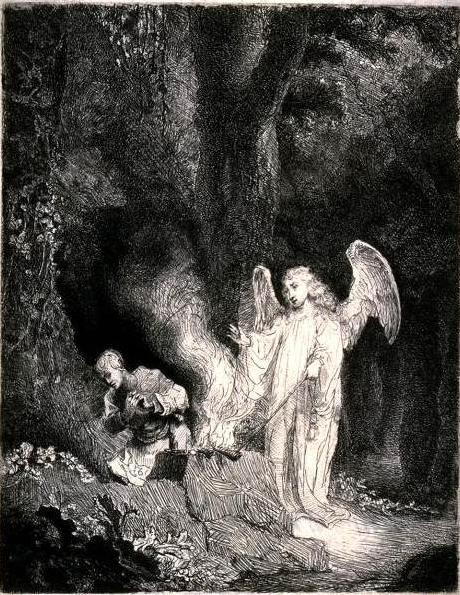

# 확신이 없었던 기드온

안녕하세요. dev.log입니다.

이번에 살펴볼 인물은 기드온입니다. 구약성경 사사기 6~8장에 등장하는 그는, 하나님의 약속을 듣고도 거듭 확인을 구했던 사람입니다. 무엇이 그렇게 불안했는지 알려면 먼저 그가 살던 때의 이야기를 볼 필요가 있습니다.

사사기는 이스라엘에 왕이 세워지기 전의 일을 기록한 책입니다. ‘사사’는 오늘날의 판사와 달리, 위기에 처한 백성을 이끌고 구해 내던 지도자를 뜻합니다. 기드온도 그중 한 사람이지만, 처음 등장할 때는 적을 피해 몸을 숨기고 있었습니다.

## 1. 숨어 있던 자리에서 나온 질문

당시 이스라엘은 7년 동안 미디안의 압박을 받고 있었습니다. 미디안과 함께 온 무리들은 이스라엘 사람들이 농사를 지으면 몰려와 수확물을 망가뜨리고 가축까지 빼앗았습니다. 사람들은 산과 동굴에 피신처를 마련해야 했습니다.

기드온은 포도주 틀에서 밀을 타작하고 있었습니다. 타작은 수확한 곡식에서 낟알을 떼어 내는 일이고, 포도주 틀은 포도즙을 짜는 시설입니다. 성경은 그가 미디안 사람들에게 들키지 않으려고 그곳에서 일했다고 설명합니다. 밀을 다루는 데 보통 쓰는 곳이 아닌, 포도즙을 짜는 시설에서 먹을 것을 마련하고 있었던 것입니다.

그때 하나님의 말씀을 전하는 천사가 기드온을 찾아옵니다. 성경에서 ‘하나님의 사자’라고 부르는 이입니다. 천사는 기드온을 용사라고 부르며 하나님이 함께하신다고 말합니다. 기드온은 그 말에 곧바로 질문을 던집니다.

> “여호와께서 우리와 함께 계시다면, 왜 이토록 많은 괴로움을 겪어야 합니까?”
> — 사사기 6:13 일부, 쉬운성경

기드온은 조상들에게 하나님이 이스라엘을 이집트에서 구해 내셨다는 이야기를 들었습니다. 그런데 지금 자신들은 먹을 것조차 지키지 못하고 있었습니다. 하나님이 함께하신다는 말과 자신들이 겪는 고통이 어떻게 맞는지 묻고 있었던 것입니다.

하나님은 기드온에게 미디안의 손에서 이스라엘을 구하라고 하십니다. 기드온은 자기 집안이 약하고 자신도 집안에서 보잘것없는 사람이라며, 어떻게 그런 일을 할 수 있겠느냐고 되묻습니다. 하나님은 그에게 함께하겠다고 약속하십니다.

기드온은 지금 말씀하시는 분이 누구인지 확인할 표징도 요청합니다. 그가 가져온 음식을 바위 위에 놓자 천사가 지팡이를 대고, 바위에서 불이 나와 음식을 태웁니다. 이 일을 겪은 기드온은 하나님을 위해 제단을 쌓습니다.

본문: [사사기 6:1~24 · 쉬운성경](https://www.godpia.com/read/reading.asp?ver=easy&vol=jdg&chap=6)

페르디난트 볼, 「기드온과 천사」, 약 1640년. 사사기 6장 21절의 장면을 후대에 그린 판화. Wikimedia Commons, 퍼블릭 도메인. [작품 출처](https://commons.wikimedia.org/wiki/File:Bol_-_Gideon_and_the_Angel.JPG)

## 2. 두려워서 밤에 한 일

미디안과 싸우러 나가기 전에, 기드온에게 집안에서 먼저 해야 할 일이 주어집니다. 하나님은 그의 아버지에게 속한 바알의 제단과 그 곁의 아세라 목상을 없애고, 하나님을 위한 제단을 세우라고 하십니다. 제단은 신에게 제물을 바치는 곳입니다. 바알과 아세라는 당시 사람들이 섬기던 다른 신들이었습니다.

사사기 6장 앞부분은 이스라엘이 하나님께 순종하지 않았다고 설명합니다. 기드온의 집안에도 다른 신을 섬기는 제단이 있었던 것입니다. 그에게는 적과 싸우기 전에 자기 집안의 잘못된 예배부터 바로잡는 일이 맡겨졌다고 읽을 수 있습니다.

기드온은 종 열 명을 데리고 명령을 실행합니다. 다만 가족과 성읍 사람들의 반응이 두려워 낮이 아닌 밤에 움직입니다. 다음 날 사람들이 기드온을 죽이겠다고 나서는 것을 보면, 그가 걱정하던 반발이 실제로 있었음을 알 수 있습니다. 이때 아버지가 나서서, 바알이 신이라면 스스로 자신을 변호하게 두라고 말합니다.

기드온은 두려움이 없어서 행동한 사람이 아니었습니다. 두려워서 밤을 골랐고, 그 시간에 맡은 일을 했습니다.

본문: [사사기 6:25~32 · 쉬운성경](https://www.godpia.com/read/reading.asp?ver=easy&vol=jdg&chap=6)

## 3. 양털로 거듭 확인하다

이후 미디안과 그 동맹 세력이 모여 진을 칩니다. 기드온에게 하나님의 영이 임하고, 그는 나팔을 불어 사람들을 모읍니다. 다른 이스라엘 지파에도 전령을 보내 함께 싸울 군사를 부릅니다. 전투를 앞두고 기드온은 하나님께 다시 확인을 구합니다.

자신을 통해 이스라엘을 구하시겠다는 약속이 이루어질지 알고 싶었던 것입니다. 그는 타작마당에 양털을 놓고, 주변 땅은 마른 채 양털에만 이슬이 내리게 해 달라고 요청합니다. 다음 날 양털에서는 그릇에 물을 받아 낼 만큼 이슬이 나옵니다.

기드온은 한 번 더 부탁합니다. 이번에는 반대로, 양털만 마르고 주변 땅에는 이슬이 있게 해 달라는 요청이었습니다. 하나님은 그 요청에도 응하십니다.

이 장면에서 기드온은 무엇을 해야 할지 처음 묻고 있는 것이 아닙니다. 이미 받은 명령과 약속을 거듭 확인하고 있습니다. 성경은 그에게 두 차례 확인이 주어졌다고 기록하지만, 모든 결정을 이런 방식으로 하라고 가르치지는 않습니다.

본문: [사사기 6:33~40 · 쉬운성경](https://www.godpia.com/read/reading.asp?ver=easy&vol=jdg&chap=6)

양털에서 이슬을 짜내는 기드온. 사사기 6장 36~40절을 후대에 그린 1873년 성경 삽화. 작가 미상, Wikimedia Commons, 퍼블릭 도메인. [작품 출처](https://commons.wikimedia.org/wiki/File:Gideon_wringing_the_fleece.jpg)

## 4. 군사는 300명만 남았다

기드온에게 모인 군사는 3만 2천 명이었습니다. 그런데 하나님은 군사가 너무 많다고 하십니다. 이스라엘이 자기 힘으로 구원받았다고 자랑하지 못하게 하려는 것이었습니다.

먼저 두려워하는 사람들을 돌아가게 하자 1만 명이 남습니다. 하나님은 그들을 물가로 데려가 물 마시는 방식에 따라 나누게 하셨고, 그중 300명만 남기셨습니다. 나머지는 집으로 돌아갔습니다.

그날 밤, 하나님은 기드온이 여전히 두렵다면 종 부라와 함께 적진에 내려가 보라고 하십니다. 그곳의 말을 들으면 싸울 용기를 얻게 될 것이라고 알려 주십니다.

기드온은 적진에서 한 군인이 동료에게 꿈 이야기를 하는 것을 듣습니다. 보리떡 하나가 굴러와 장막을 무너뜨렸다는 꿈이었습니다. 동료는 하나님이 미디안을 기드온에게 넘겨주실 뜻이라고 풀이합니다.

그 말을 들은 기드온의 반응을 쉬운성경은 이렇게 전합니다.

> “하나님께 감사드리고 이스라엘의 진으로 돌아왔습니다.”
> — 사사기 7:15 일부, 쉬운성경

기드온은 300명을 세 무리로 나누고, 나팔과 횃불을 넣은 항아리를 나누어 줍니다. 밤에 적진을 둘러싼 이들이 나팔을 불고 항아리를 깨뜨리자 횃불이 드러납니다. 미디안 진영은 혼란에 빠집니다. 본문은 하나님이 적군끼리 서로 칼로 치게 하셨다고 전합니다. 미디안 군대는 달아나고, 이스라엘 사람들이 추격에 나섭니다.

본문: [사사기 7:1~25 · 쉬운성경](https://www.godpia.com/read/reading.asp?ver=easy&vol=jdg&chap=7)

## 5. 승리 뒤에 남은 문제

기드온의 이야기는 승리로 끝나지 않습니다. 추격 중에 그는 숙곳과 브누엘이라는 두 성읍에 지친 군사들이 먹을 빵을 요청합니다. 그러나 두 성읍은 그가 미디안 왕들을 아직 붙잡지 못했다며 돕기를 거절합니다. 왕들을 붙잡은 뒤 돌아온 기드온은 그곳 사람들에게 가혹하게 보복합니다.

전쟁이 끝나자 이스라엘 사람들은 기드온과 그의 후손에게 자신들을 다스려 달라고 요청합니다. 기드온은 이를 거절하며 하나님이 다스리실 것이라고 말합니다. 하지만 곧이어 한 행동은 또 다른 문제를 남깁니다.

그는 전리품으로 얻은 금을 모아 에봇을 만들고 자기 성읍에 둡니다. 에봇은 성경에서 제사장이 입는 의복을 가리킬 때도 쓰이는 말입니다. 여기서 기드온이 만든 물건의 정확한 모양은 자세히 나오지 않습니다.

문제는 사람들이 그 물건을 숭배하기 시작했다는 데 있습니다. 본문은 에봇이 기드온과 그의 집안에 올무가 되었다고 평가합니다. 올무는 짐승을 잡는 덫인데, 여기서는 그들을 잘못된 길에 빠뜨린 것을 뜻합니다. 처음에는 다른 신을 섬기는 제단을 허물었던 사람이, 나중에는 사람들이 숭배하는 물건을 남긴 셈입니다.

기드온이 살아 있는 동안 땅은 40년간 평온했습니다. 그러나 그가 죽은 뒤 이스라엘은 다시 바알을 섬깁니다.

기드온은 두려워하면서도 맡은 일을 했고, 그 과정에서 거듭 확인을 구했습니다. 백성을 구하는 일을 해냈지만 이후의 선택까지 모두 옳았던 것은 아닙니다. 그의 이야기를 읽을 때는 처음의 망설임과 전쟁의 승리, 마지막에 남긴 문제를 함께 보게 됩니다.

본문: [사사기 8:4~35 · 쉬운성경](https://www.godpia.com/read/reading.asp?ver=easy&vol=jdg&chap=8)

---

