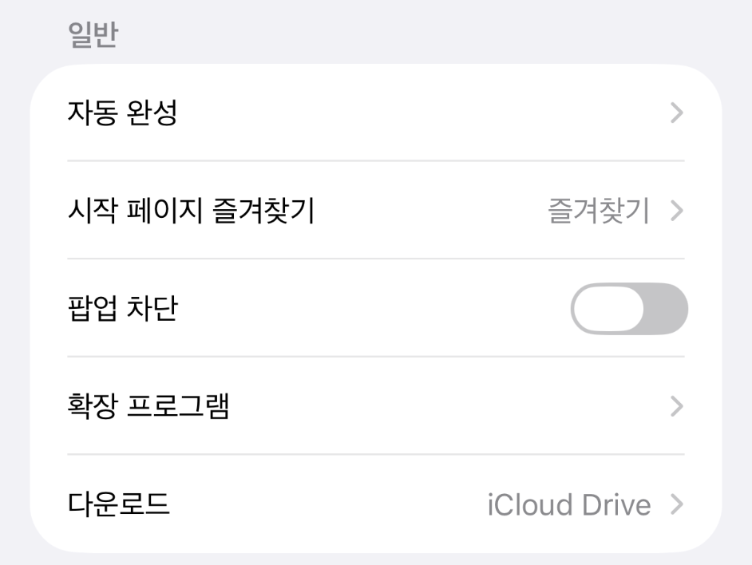

# 아이폰 팝업창이 안 열릴 때

안녕하세요. dev.log입니다.

아이폰 Safari에서 예매 버튼을 눌렀는데 다음 창이 뜨지 않는다면, **팝업 차단**을 확인해 볼 수 있습니다. 별도 창이 차단된 경우에 확인할 설정입니다.

**이미 대기 중이라면** 새로고침, 브라우저 변경, 쿠키 삭제 대신 예매처의 안내를 따라 주세요. 아래 설정은 예매 시작 전에 확인하는 편이 좋습니다. 웹사이트 데이터를 지우면 로그인 유지에 쓰이는 정보도 삭제될 수 있습니다. [Apple 데이터 삭제 안내](https://support.apple.com/ko-kr/105082)

## 1. Safari 설정으로 이동

**설정 → 앱 → Safari** 순서로 들어갑니다.

화면을 내려 **일반** 영역의 **팝업 차단**을 찾으면 됩니다. 아래 실제 화면에서는 ‘시작 페이지 즐겨찾기’ 바로 아래에 있습니다. [Apple 팝업 설정 안내](https://support.apple.com/ko-kr/102524)

*실제 설정 화면의 ‘일반’ 영역. 팝업 차단이 꺼져 있어 이미 팝업을 허용한 상태입니다.*

## 2. 필요한 동안만 팝업 허용

공식 예매 사이트에서 새 창을 허용하라는 안내가 있다면, **팝업 차단을 잠시 끕니다.** 위 화면처럼 회색으로 꺼져 있다면 더 바꿀 필요는 없습니다.

사전 점검 중이라면 Safari로 돌아가 해당 단계가 열리는지 확인해 보세요. 신뢰할 수 있는 공식 사이트에서 필요한 동안만 허용하는 방식입니다.

**위조된 웹사이트 경고와 크로스 사이트 추적 방지는 그대로 둡니다.** 팝업을 허용하려고 다른 보안 설정까지 끌 필요는 없습니다. [Apple 보안 설정 안내](https://support.apple.com/ko-kr/guide/iphone/-iphb01fc3c85/ios)

## 3. 이용 후에는 다시 켜기

예매를 마치면 같은 위치에서 **팝업 차단을 다시 켭니다.**

이미 꺼져 있는데도 예매창이 열리지 않는다면 다른 원인일 수 있습니다. 예매처의 오류 안내와 공지를 확인해 주세요. 서버 지연이나 대기열, 매진 문제는 팝업 설정으로 해결되지 않습니다.
