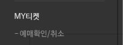
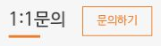

# 예스24 티켓, 결제됐는데 예매 내역이 없을 때

안녕하세요. dev.log입니다.

결제 알림까지 받았는데 예매 내역에는 공연이 보이지 않는다면 당황스럽죠. 표는 잡힌 건지, 결제만 된 건지부터 확인하고 싶을 텐데요. 먼저 볼 곳은 예스24 티켓 전체 메뉴의 **MY티켓 > 예매확인/취소**입니다. 여기에서 해당 공연의 예매 내역과 예매번호를 확인할 수 있습니다.

## 1. 결제 알림을 받았다면 예매번호 확인

[예스24 공식 FAQ](https://www.yes24.com/Mall/Help/FAQ?faqGb=38&faqSubGb=YG2)는 결제 완료 메시지를 받았더라도 예매번호가 생성되지 않았다면 정상 예매가 아니라고 안내합니다. 결제 알림만으로는 좌석이 확보됐는지 판단할 수 없습니다.

<!-- 출처: https://ticket.yes24.com/UserGuide/FAQ · MY티켓의 예매확인/취소 메뉴. -->

이때 찾는 것은 **예매번호**입니다. 뒤에서 고객센터에 문의할 때 필요한 **승인번호**는 결제 정보에 있는 번호라 서로 다릅니다.

내역에서 정상 예매가 확인된다면, 이 문제 때문에 취소하거나 다시 결제할 필요는 없습니다.

## 2. 예매 내역 없이 결제만 됐다면

공식 FAQ는 동시 접속 중 여러 사람이 같은 좌석을 선택할 수 있다고 설명합니다. 이런 경우에는 결제를 먼저 완료한 고객의 예매가 성립한다고 안내합니다.

**예매 내역 없이 결제만 완료된 경우에는 영업일 기준 2~3일 내 자동 취소**가 안내돼 있습니다. 이는 취소 처리에 관한 안내로, 카드사의 최종 환급 시점은 이 FAQ에서 정하지 않습니다.

## 3. 영업일 3일 이후에도 취소되지 않았다면

티켓 고객센터 **1544-6399** 또는 **1:1 문의**로 결제 상태를 문의할 수 있습니다. 공식 FAQ는 예매자 본인이 결제 정보의 승인번호를 확인한 뒤 문의하도록 안내하고 있습니다.

<!-- 출처: https://ticket.yes24.com/UserGuide/FAQ · 예스24 티켓 고객센터 1544-6399와 운영 시간. 점심시간 및 휴무일도 확인한다. -->

<!-- 출처: https://ticket.yes24.com/UserGuide/FAQ · 공식 이용안내의 1:1문의 → 문의하기 진입 버튼. -->

문의에 필요한 승인번호 외에 결제 일시·금액, 예매하려던 공연명을 정리해 두면 어떤 결제인지 설명하기 편합니다. 예매 내역이 없다는 점과 결제 후 지난 기간도 함께 남기면 상황을 전달하는 데 도움이 됩니다.

공연일이 임박했다면 취소 처리 기간만 기다리기보다는 고객센터에 먼저 문의하는 편이 좋습니다.

<!-- 게시 전 검토용 초안. 2026년 10월 28일 공식 공개 화면 확인. 미게시. 이미지가 포함된 독립 열람본은 review.html이며, 이 Markdown의 이미지 경로는 로컬 screenshots 폴더 기준입니다. -->
