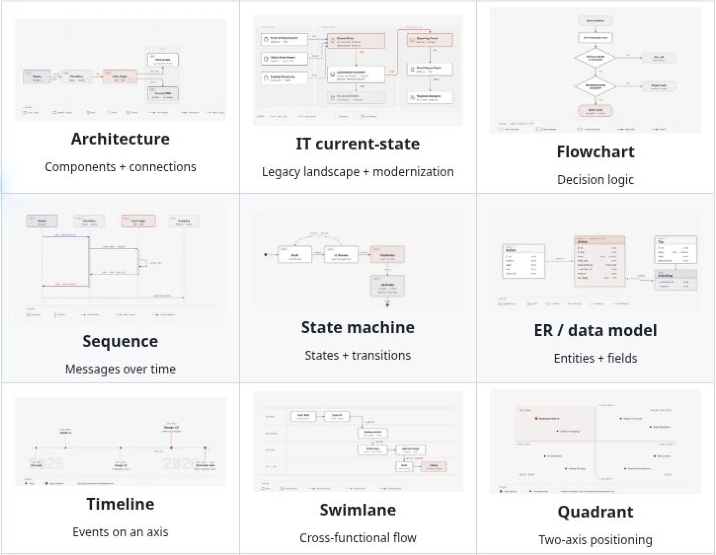
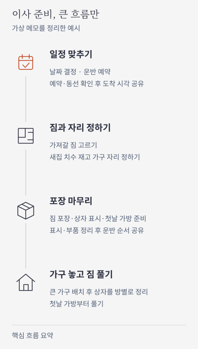
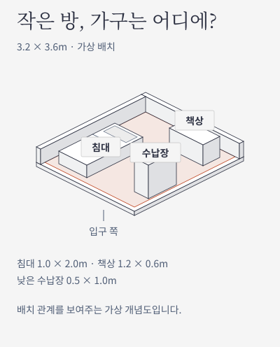
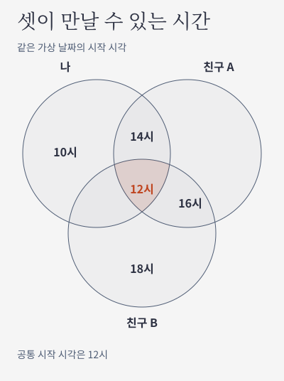

# 설명을 그려주는 AI 스킬, diagram-design

안녕하세요. dev.log입니다.

오늘은 회사 팀장님이 추천해주신 **AI 스킬, diagram-design**을 소개하려고 합니다. 팀원들도 현업에서 많이 쓰고 있고, 저도 자주 사용하고 있어서 꼭 한번 추천드리고 싶었습니다. 어떻게 쓰는지 예시와 함께 정리해봤습니다.

다른 팀에 이메일로 프로젝트를 설명하다 보면 글이 길어집니다. 저는 이런 내용을 한눈에 전달하고 싶을 때 사용합니다. 팀장님께 보고드릴 때, 다른 사람에게 코드를 설명할 때, 사소한 배치나 구도를 보여줄 때도 활용하고 있습니다.

## AI에게 그림 그리는 방법을 알려주는 스킬

**스킬**은 AI가 작업할 때 참고하는 지침입니다. diagram-design에는 내용에 맞는 그림을 고르고, 도형과 선을 배치하고, 색과 글자를 정리하는 방법이 담겨 있습니다.

필요한 내용을 말하면 AI가 이 지침을 참고해 그림을 만들어줍니다. 코드를 직접 작성하지 않아도 되고, 바꾸고 싶은 부분도 말로 요청하면 됩니다. [공식 소개](https://github.com/cathrynlavery/diagram-design)

*GitHub 공식 README에 소개된 그림 예시 중 일부. [원본 보기](https://github.com/cathrynlavery/diagram-design#what-it-makes) · ©2025 Cathryn Lavery, MIT.*

## 먼저 AI에게 이 주소부터 알려주세요

간단하게 시작하려면 평소 쓰는 **클로드나 GPT에 GitHub 주소를 주고, 쓸 수 있게 준비해달라고 부탁하면 됩니다.** 아래 문장을 그대로 복사해보세요.

> https://github.com/cathrynlavery/diagram-design
> 이 저장소를 살펴보고, diagram-design을 내가 쓸 수 있는 스킬로 준비해줘. 지금 환경에서 직접 추가할 수 있으면 추가해주고, 안 된다면 필요한 설정만 쉽게 알려줘.

직접 설치할 수 없는 대화창에서는 필요한 설정을 안내받는 방식입니다. [공식 설치 안내](https://github.com/cathrynlavery/diagram-design#install)

## 이사 메모가 그림이 되기까지

날짜, 예약, 짐 정리, 역할 분담이 얽힌 **이사 준비**로 살펴보겠습니다. 아래 그림은 AI가 스킬 지침을 읽고 적용해 만든 가상 예시이고, 요청문은 따라 써볼 수 있게 정리했습니다.

### 1. 생각나는 대로 메모하기

처음부터 순서를 예쁘게 정리할 필요는 없습니다. 알고 있는 내용을 적고, 아직 모르는 것은 그대로 남겨둡니다.

> 이사 준비 메모. 날짜는 아직 안 정했음. 나는 서로 가능한 날을 모아서 날짜부터 정하고 운반 일정 예약할게. 같이 사는 사람은 새집 치수 재고 가구 자리 정하기. 양쪽 집에서 짐 나르는 동선도 봐줘. 도착 시각 공유는 예약이랑 동선 확인 끝나면 내가. 아, 포장 자재는 네가 준비. 나는 가져갈 짐 고르고 안 가져갈 짐 정리한 뒤 잘 안 쓰는 짐부터 포장. 가구 자리를 정해둬야 이삿날 안 헤매겠지. 상자에 방 이름 쓰는 건 내가, 배선 사진이랑 분리 부품 챙기는 건 네가. 첫날 쓸 물건 가방은 내가 따로. 운반 순서는 네가 공유하되 상자 표시랑 부품 정리 끝나고 배치도도 같이 보내자. 당일 나는 출발 전 남은 짐 확인. 새집 방 이름 표시랑 큰 가구 배치는 네가. 큰 가구 자리 잡으면 내가 상자를 방별로 놓고 첫날 물건부터 풀게.

### 2. 이렇게 요청하기

> diagram-design으로 위 이사 메모를 그림으로 정리해줘.

### 3. 복잡한 메모를 큰 흐름으로 보기

세부 할 일을 그대로 옮기면 그림도 긴 체크리스트가 됩니다. 이번에는 비슷한 일을 묶고, **준비부터 정리까지의 큰 흐름**을 네 단계로 나눴습니다.

*핵심 흐름을 요약한 가상 예시입니다. 세부 할 일과 담당자는 덜어냈으며, 자세한 내용은 위 메모에서 확인할 수 있습니다.*

### 4. 너무 복잡하면 덜어달라고 하기

첫 그림에 정보가 너무 많다면, 어떤 부분이 중요한지 다시 알려주면 됩니다.

> 세부 할 일을 전부 넣기보다, 처음 보는 사람도 이해할 수 있게 큰 흐름만 남겨줘. 비슷한 일은 묶고 중요한 순서만 보여줘.

**한 번에 완성하려고 하기보다, 그림을 보면서 고친다**고 생각하면 편합니다.

## 흐름도 말고도 그릴 수 있습니다

그림 이름이나 배치 방법까지 알 필요는 없습니다. 필요한 내용을 툭 던지면, 스킬이 어울리는 방식으로 정리해줍니다. 마음에 들지 않는 부분만 말로 바꾸면 되고요.

### 가구는 어디에 놓을까

작은 방에 가구를 어떻게 놓을지 궁금할 때도 쓸 수 있습니다. 아래 예시는 가로 3.2m, 세로 3.6m인 방에 침대와 책상, 수납장을 놓는 상황입니다.

> diagram-design으로 작은 방에 침대랑 책상, 수납장을 배치해줘.

*가상 공간의 배치를 설명하는 그림입니다.*

### 셋이 언제 만날 수 있을까

같은 날 만날 수 있는 시작 시간이 ‘나: 10·12·14시, 친구 A: 12·14·16시, 친구 B: 12·16·18시’라면 어떨까요? 가능한 시간을 알려주고 간단히 부탁하면 됩니다.

> diagram-design으로 세 사람이 같이 만날 수 있는 시간을 한눈에 정리해줘.

*같은 가상 날짜의 후보 시간입니다.*

## 이런 그림도 만들 수 있습니다

GitHub에는 **45가지 그림 유형**이 소개되어 있습니다. 이름을 외울 필요는 없습니다. 보여주고 싶은 내용에 맞춰 골라달라고 하면 됩니다.

| 보여주고 싶은 것 | 어울리는 그림 |
|---|---|
| 순서와 갈림길 | 흐름도, 상태 변화를 보여주는 그림 |
| 일정과 역할 | 타임라인, 일정표, 역할별 흐름도 |
| 비교와 비중 | 사분면, 막대그래프, 비중을 보여주는 트리맵 |
| 묶음과 공통점 | 가지형 그림, 포함 관계, 벤 다이어그램 |
| 시스템의 구성과 연결 | 시스템 구성도, 데이터 관계도 |
| 경험과 공간 | 고객 여정 지도, 서비스 전체 흐름, 공간 배치도 |

위 표는 용도별로 묶은 예입니다. **“이 내용을 설명하기 좋은 그림을 골라줘”**라고 요청해도 됩니다. [전체 유형과 예시](https://github.com/cathrynlavery/diagram-design#what-it-makes) · [공식 갤러리](https://cathrynlavery.github.io/diagram-design/)

그림의 종류와 저장할 파일은 별개입니다. 기본은 브라우저에서 여는 **HTML**이고, 확대해도 선명한 **SVG**, 이메일이나 슬라이드에 넣기 좋은 **PNG**로도 내보낼 수 있습니다. 밝은 배경·어두운 배경이나 설명을 더 붙인 스타일도 고를 수 있습니다. [스타일 안내](https://github.com/cathrynlavery/diagram-design/blob/main/skills/diagram-design/SKILL.md) · [파일 내보내기](https://github.com/cathrynlavery/diagram-design/blob/main/skills/diagram-design/references/export.md)

말로 설명하기 어려운 내용이 있다면, 메모 하나부터 그림으로 옮겨보세요. 저처럼 설명할 일이 많은 분들께 추천드립니다.

---

프로젝트: [cathrynlavery/diagram-design](https://github.com/cathrynlavery/diagram-design) · 제작: Cathryn Lavery · [MIT 라이선스](https://github.com/cathrynlavery/diagram-design/blob/main/LICENSE)

기능 안내는 2026년 10월 29일 공개 문서를 기준으로 정리했습니다.
