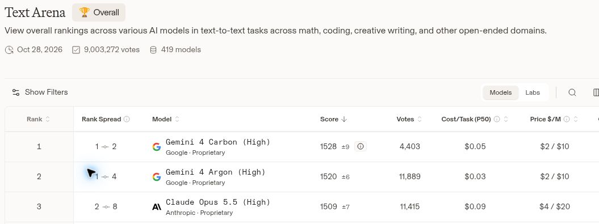
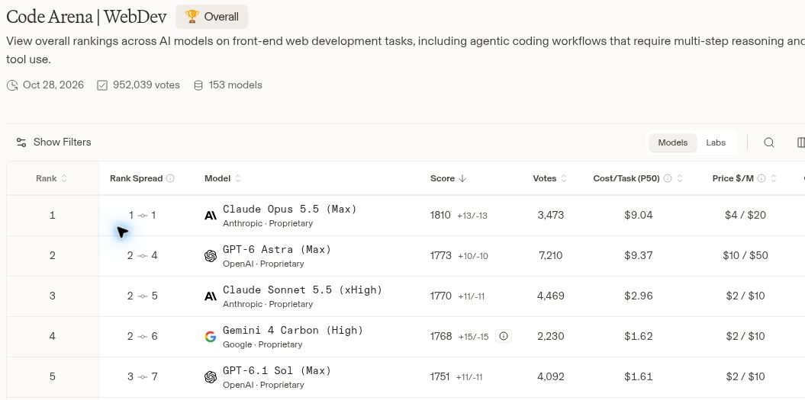

안녕하세요. dev.log입니다.

구글이 10월 28일 **Gemini 4 Carbon**을 발표했습니다. 어떤 AI를 쓰고 있든 새 모델이 나오면 궁금해집니다. 기존 모델보다 무엇이 좋아졌는지, 내가 하는 일에도 도움이 될지가 궁금하죠.

이번에는 **Carbon과 Opus 5.5를 중심으로**, **GPT-6 Astra**도 함께 비교했습니다. 종합 점수에서는 Carbon이 앞섰지만, 웹 제작 결과물에 대한 평가는 Opus 5.5가 더 높았습니다. 어려운 개발 과제에서는 Astra가 앞서는 항목도 있었고요. 어떤 일을 맡기느냐에 따라 결과가 갈렸습니다.

공개된 시험 점수와 Arena 순위, 가격을 차례로 살펴보겠습니다. 이전 모델인 Gemini 4 Argon은 Carbon이 얼마나 좋아졌는지 확인하는 기준으로만 덧붙였습니다.

*구글의 2026년 10월 28일 공식 발표 화면. [발표 원문](https://blog.google/innovation-and-ai/models-and-research/gemini-models/introducing-gemini-4-carbon/)*

## 1. Gemini 4 Carbon, 무엇이 달라졌나

Carbon은 구글의 새로운 상위 AI 모델입니다. 구글은 여러 단계를 거치는 개발 작업을 오래 이어가는 능력과 보안 문제를 찾고 수정하는 능력을 강조했습니다. 코드를 한 번 작성하는 데서 끝나는 것이 아니라, 문제가 생기면 원인을 찾고 다시 고치며 작업을 이어가는 쪽입니다.

다만 **발표와 일반 사용 시작은 구분해야 합니다.** 구글은 일부 사이버 보안 담당자에게 먼저 제공하고, 개발자와 일반 사용자에게는 순차적으로 확대하겠다고 밝혔습니다. 아직 누구나 Gemini 앱에서 선택해 쓸 수 있는 단계는 아닙니다. [구글 발표](https://blog.google/innovation-and-ai/models-and-research/gemini-models/introducing-gemini-4-carbon/)

## 2. Carbon vs Opus 5.5, 성능 비교

먼저 눈에 들어온 건 Artificial Analysis의 **Intelligence Index 59점**입니다. 여러 모델을 평가하는 외부 업체의 종합 지표로, 업무·코딩·과학·일반 지식에 걸친 9개 시험을 묶습니다. Carbon은 이 지표에서 1위에 올랐습니다. [Artificial Analysis 평가](https://artificialanalysis.ai/evaluations/artificial-analysis-intelligence-index)

아래는 구글의 공개 비교표에서 성격이 다른 평가 네 가지를 골라 정리한 결과입니다. Carbon과 Opus 5.5를 나란히 놓고, Astra도 함께 확인했습니다. 굵은 숫자는 **세 모델 중** 가장 높은 값입니다.

| 평가 | Gemini 4 Carbon | Claude Opus 5.5 | GPT-6 Astra |
|---|---:|---:|---:|
| 종합 역량 · AA Index v5 | **59** | 58 | 57 |
| 터미널 작업 · Terminal-Bench 4.0 | **65.2%** | 59.6% | 59.1% |
| 소프트웨어 개발 · FrontierSWE 2.0 | 61.2% | 62.3% | **65.5%** |
| PC 화면 조작 · OSWorld 2.1 오프라인 | 81.5% | **87.2%** | 80.9% |

*구글 공개 비교표 기준으로, 항목별 출처와 실행 조건이 다릅니다. Gemini는 최고 추론 설정, 경쟁 모델은 공개된 최고·최선 가용 설정을 사용했습니다. OSWorld는 인터넷을 쓰지 않는 82개 과제이며, Gemini 수치는 3회 실행 중 최고 결과입니다. [평가 방법](https://deepmind.google/models/evals-methodology/gemini-4-carbon/)*

**Carbon과 Opus 5.5의 차이는 한 방향으로 정리되지 않습니다.** 종합 점수는 Carbon이 1점 높고, 명령어로 파일이나 프로그램을 다루는 터미널 작업에서는 5.6%p 앞섰습니다. 반면 PC 화면을 보고 버튼을 누르거나 앱을 조작하는 평가에서는 Opus 5.5가 5.7%p 높았습니다.

긴 개발 과제를 수행하는 FrontierSWE에서는 Carbon 61.2%, Opus 5.5 62.3%로 차이가 작았습니다. 이 항목의 세 모델 중 최고점은 Astra의 65.5%였습니다. 종합 점수가 높다고 개발 작업에서도 항상 앞서는 것은 아닌 셈입니다.

이전 Argon과 비교하면 발전 폭이 더 뚜렷합니다. 종합 점수는 50점에서 59점, 터미널 작업은 57.1%에서 65.2%로 올랐습니다. [Carbon·Argon 비교](https://artificialanalysis.ai/models/comparisons/gemini-4-carbon-vs-gemini-4-argon)

터미널 작업 점수도 전체 모델 중 1위라는 뜻은 아닙니다. Artificial Analysis의 해당 시험에는 Carbon보다 높은 Kimi 모델도 있습니다. 비교 대상을 어디까지 잡느냐에 따라 결론이 달라집니다. [Terminal-Bench 순위](https://artificialanalysis.ai/evaluations/terminalbench-4-0)

## 3. Arena 비교: Text는 Carbon, 웹 제작은 Opus 5.5

시험 점수와 함께 보는 곳이 **Arena**입니다. 모델 이름을 가린 두 결과를 보여주고, 사용자가 더 마음에 드는 쪽을 고릅니다. 이런 선택을 모아 상대 점수를 계산하므로, 정답률보다는 사람들이 어떤 결과를 더 선호했는지에 가까운 평가입니다. [Arena 소개](https://arena.ai/faq/)

10월 29일 확인한 **Text Arena 전체 순위에서 Carbon은 1위, 1,528점**이었습니다. 수학·코딩·글쓰기 등 여러 텍스트 요청을 아우르는 부문입니다. 아직 초기 집계로 표시돼 있고, 불확실성을 반영한 순위 범위는 1~2위입니다. [Text Arena](https://arena.ai/leaderboard/chat/text)

*Text Arena 전체 순위. 10월 29일 캡처했으며 화면의 집계 날짜는 10월 28일입니다. [현재 순위](https://arena.ai/leaderboard/chat/text)*

반면 웹사이트와 웹앱 결과물을 비교하는 **WebDev Arena에서는 4위**였습니다.

*웹 제작 결과물의 선호도를 비교하는 WebDev Arena. 10월 29일 캡처, 화면 집계 날짜는 10월 28일. [현재 순위](https://arena.ai/leaderboard/code/webdev)*

| WebDev 전체 순위 | 모델 · 추론 설정 | 점수 | 투표 수 |
|---|---|---:|---:|
| 1위 | Claude Opus 5.5 · Max | 1,810 ±13 | 3,473 |
| 2위 | GPT-6 Astra · Max | 1,773 ±10 | 7,210 |
| 4위 | Gemini 4 Carbon · High | 1,768 ±15 | 2,230 |
| 11위 | Gemini 4 Argon · High | 1,679 ±11 | 3,437 |

*2026년 10월 29일 확인한 [WebDev Arena 전체 순위](https://arena.ai/leaderboard/code/webdev). 비교 대상 네 모델만 추렸으며, Carbon은 초기 집계(Preliminary)입니다. 표의 순위는 전체 순위를 그대로 썼습니다.*

Carbon과 Astra의 차이는 5점입니다. 두 모델의 점수 범위가 겹치고 Carbon의 순위 범위도 2~6위라서, 숫자만으로 확실한 우열을 정하기는 이릅니다. 이때 ± 표시는 통계적인 오차 범위이며, 1,768점이 정답률 76.8% 같은 의미는 아닙니다. [순위 계산 방식](https://arena.ai/blog/ranking-method)

그래도 읽을 수 있는 방향은 있습니다. **Carbon은 이전 Gemini보다 웹 제작 평가가 크게 좋아졌고, 현재 웹 제작 선두는 Opus 5.5입니다.** Text 1위와 WebDev 4위가 동시에 나오는 이유도 결국 보는 작업이 다르기 때문입니다.

## 4. 가격과 사용 가능 여부

구글이 발표한 Carbon의 API 출시 초기 가격은 입력 100만 토큰당 **2달러**, 출력은 **10달러**입니다. 초기 기간이 끝나면 **4달러·20달러**로 바뀝니다. 토큰은 AI가 읽거나 만들어낸 글의 양을 세는 단위이고, 이 가격은 Gemini 앱의 월 구독료와는 별개입니다. [공식 가격 안내](https://blog.google/innovation-and-ai/models-and-research/gemini-models/introducing-gemini-4-carbon/)

초기 가격만 보면 눈길이 가지만, 아직 일반 공개 전인 만큼 지금 당장 구독을 옮길 근거로 삼기는 어렵습니다. 실제 사용할 수 있게 됐을 때 응답 속도와 사용 한도, 내 작업에서의 결과를 함께 봐야겠습니다.

## 5. 발표 이후 커뮤니티 반응

발표 직후 [Hacker News 토론](https://news.ycombinator.com/item?id=50276792)에서는 언제, 어디서 쓸 수 있느냐는 이야기가 이어졌습니다. [Reddit의 Claude 커뮤니티](https://www.reddit.com/r/ClaudeAI/comments/1xhu9ez/google_introduced_gemini_4_carbon_allegedly_the/)에도 점수뿐 아니라 비용을 함께 봐야 한다거나, 실제로 작업하는 모습을 보고 싶다는 댓글이 있었습니다.

발표를 접한 일부 반응이지만 공감되는 지점입니다. 매일 사용하는 입장에서는 점수 몇 점보다 내가 맡긴 일을 제대로 끝내는지, 얼마나 기다려야 하는지가 더 중요하니까요.

## 6. Carbon과 Opus 5.5, 어떤 모델을 고를까

공개된 결과만 놓고 보면 **종합 역량과 터미널 작업은 Carbon**, **웹 제작 결과물의 선호도와 PC 화면 조작은 Opus 5.5** 쪽에 무게가 실립니다. 여기에 개발 과제 성능을 중시한다면 **GPT-6 Astra**도 빼놓기 어렵습니다.

웹사이트 제작이 목적이라면 현재 Arena에서 앞선 Opus 5.5의 결과를, 터미널 작업이 많다면 Carbon의 강점을 눈여겨볼 만합니다. 지금 어떤 모델을 쓰는지보다 앞으로 어떤 일을 맡길지가 선택의 기준이 되겠습니다.

다만 Carbon은 아직 일반 공개 전입니다. **지금의 결론은 ‘Opus 5.5를 대체했다’보다는 ‘작업에 따라 맞붙을 강력한 비교 대상이 나왔다’에 가깝습니다.** 공개 이후에는 이 점수 차이가 실제 작업 시간과 완성도에서도 이어지는지가 관건이겠습니다.

*발표 자료와 공개 평가를 기준으로 작성했습니다. 확인일: 2026년 10월 29일.*
