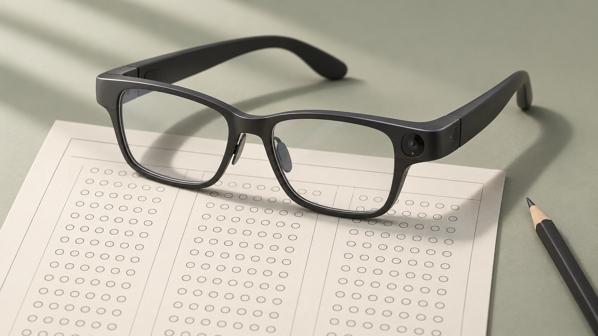

안녕하세요. dev.log입니다.

지난 11월 19일 수능에서는 1교시가 시작되기 전에 평소 쓰던 안경도 벗어 책상 위에 놓도록 했습니다. 겉보기에는 일반 안경과 비슷한 스마트안경에 작은 카메라가 달려 있을 수 있어, 감독관이 안경을 하나씩 확인하는 절차를 마련한 겁니다.

토익 정기시험에서는 일반 안경을 확인한 뒤 안경테에 스티커를 붙입니다. 이렇게 검사 방식이 다르고, 시험에 따라 필기구나 입실 시각도 달라집니다. 아래에 시험별 공고를 모아 무엇을 챙겨야 하는지, 시험장에서는 어떤 확인을 받는지 정리했습니다.

[11월 28일 인천 임용](#인천-중등교사-임용-1차)은 **오전 8시 10분까지 입실**합니다. [11월 29일 토익 정기시험](#토익-정기시험)에는 **샤프 대신 일반 연필**을 준비합니다.

[서울여대 논술](#서울여대-논술고사) · [국가자격시험](#한국산업인력공단-국가자격시험) · [고교 기말고사](#고교-2학기-기말고사) · [수능](#수능-안경-검사와-스마트안경-제재)

2026년 11월 27일 한국시간 기준입니다.

## 시험별로 챙길 물건

### 인천 중등교사 임용 1차

- **입실 마감**은 11월 28일 오전 8시 10분입니다. 스마트안경 등을 확인하기 위해 마감이 10분 앞당겨졌습니다. 인천의 국립·공립·사립 응시자 모두에게 적용됩니다. [인천교육청 11월 25일 변경 공고](https://www.ice.go.kr/ice/na/ntt/selectNttInfo.do?bbsAllTy=exam&bbsAllView=Y&mi=12237&nttSn=3389550)
- **가져온 전자기기**는 전원을 끄고 1교시 시작 전에 감독관에게 제출합니다. 매 교시 시작 전에는 스마트안경을 가지고 있거나 착용했는지 확인합니다. [11월 20일 응시자 유의사항 PDF](https://www.ice.go.kr/upload/ice/na/bbs_1777/2026/11/d805080018564e09a3351943a3bb70c3.pdf)

### 토익 정기시험

11월 29일 제584회부터 책상 위에 둘 수 있는 물건은 다음 네 종류입니다. [한국토익위원회 공지](https://exam.toeic.co.kr/news/noticeView.php?noticeCode=10110) · [정기시험 일정](https://exam.toeic.co.kr/receipt/examSchList.php)

- **신분증**은 한국토익위원회가 인정하는 것으로 준비합니다.
- **일반 연필**은 최대 2자루입니다. 개인 샤프는 가져갈 수 없습니다.
- **지우개**는 커버를 벗긴 것 1개만 둘 수 있습니다.
- **아날로그 손목시계**는 손목에서 풀어 책상에 둡니다.

일반 안경은 감독관이 검사한 뒤 안경테에 보안 스티커를 붙입니다.

입실 통제와 기기 제출 안내 후에도 AI 안경 등 AI 스마트기기를 소지하거나 사용한 사실이 확인되면 퇴실 처리하며, 해당 성적은 무효가 되고 4년간 응시가 제한됩니다. 토익스피킹·라이팅은 각 시험의 수험자 안내를 확인해야 합니다. [한국토익위원회 시험관리규정 제14조](https://exam.toeic.co.kr/news/noticeView.php?noticeCode=10050)

### 서울여대 논술고사

서울여대의 2027학년도 논술고사 안내입니다. [서울여대 논술고사 공지](https://admission.swu.ac.kr/bbs/board.php?bo_table=notice&wr_id=29299)

- **시계**는 아날로그 손목시계만 허용하며, 시험 내내 손목에 찹니다.
- **답안 작성과 수정**에는 학교에서 나눠 주는 펜과 수정테이프를 씁니다.
- **전자기기**를 부득이하게 가져왔다면 전원을 완전히 끄고 감독관의 안내에 따라 제출합니다.
- **단추가 많은 옷과 후드티**는 착용을 자제하도록 권고했습니다.

### 한국산업인력공단 국가자격시험

- **준비물**은 응시할 자격 종목과 회차의 공고에서 확인합니다.
- **휴대전화 등 전자기기**는 시험 전에 전원을 완전히 끄고 감독관의 확인을 받아 제출합니다. [고용노동부·공단 안내](https://www.moel.go.kr/news/enews/report/enewsView.do?news_seq=20295)

다른 대학의 논술·면접은 지원 대학 입학처에서, 공무원 채용시험과 다른 어학시험은 해당 회차 공고에서 반입 금지 물품과 제출 시각을 확인합니다.

### 고교 2학기 기말고사

교육부는 2026학년도 2학기 기말고사부터 전국 고등학교에 다음 대책을 우선 적용한다고 밝혔습니다. 중학교는 이 방안을 참고해 감독을 강화합니다.

- **필기구**는 학교에서 나눠 줍니다. 개인 필기구 중에는 흑색 연필만 휴대할 수 있습니다.
- **전자기기**는 시험 전에 학교에서 걷습니다. 입실 전이나 시험 직후에는 금속탐지기로 전자기기 소지 여부를 확인할 계획입니다.
- **안경과 복장**은 매 교시 감독관이 확인합니다. 단추 없는 옷을 권장하며, 단추가 있으면 스티커를 제공합니다.

**이미 기말고사를 시작한 일부 고3**은 학교가 필기구를 일괄 지급하기 어려우면 개인 필기구를 쓸 수 있습니다. 이 경우 매 교시 필기구를 점검합니다. 금속탐지기는 부정행위가 의심되거나 학생이 시험실에 다시 들어올 때 등에 쓰도록 했습니다.

교육부는 스마트기기 소지·사용이 적발되면 당일 전 과목을 0점 처리하는 방안도 발표했습니다. 고등학교에는 최대 퇴학까지 징계할 수 있도록 권고할 계획입니다. [교육부 고3 적용 안내와 징계 방안](https://www.korea.kr/news/policyNewsView.do?newsId=148976387)

대구시교육청은 11월 23일 지역 고교에 시험용 필기구와 금속탐지기를 지원한다고 밝혔습니다. 대구에서는 부정행위가 의심되는 경우 등에 한해 금속탐지기를 몸에 닿지 않게 사용하도록 안내했습니다. [대구시교육청 보도자료](https://www.dge.go.kr/pr/na/ntt/selectNttInfo.do?mi=9870&nttSn=2224703)

## 수능 안경 검사와 스마트안경 제재

11월 19일 치른 2027학년도 수능에서는 일반 안경을 쓸 수 있었습니다. 단추형 카메라에 대비해 옷 단추에는 스티커를 붙이도록 했습니다. 단추 없는 옷을 입고 장신구 착용을 줄이는 것은 권고 사항이었습니다. [정부 수능 담화](https://www.korea.kr/news/policyNewsView.do?newsId=148975916) · [관계부처 합동 안내](https://www.opm.go.kr/opm/news/press-release.do?articleNo=164227&mode=view)

- **1교시 전**에는 안경을 내려놓고 검사받도록 했습니다. 반입이 금지된 스마트안경을 가져왔다면 이때 감독관에게 제출해야 했습니다.
- **매 교시** 감독관이 수험생이 쓰고 있는 안경을 확인하도록 했습니다.
- **3교시 전**에는 수험생의 휴대물품 전체를 다시 점검하도록 했습니다.

교육부가 안내한 스마트안경 제재는 적발 상황에 따라 달랐습니다. [교육부 스마트안경 제재 안내](https://www.moe.go.kr/boardCnts/viewRenew.do?boardID=340&boardSeq=107580&lev=0&m=031101&opType=N&page=1&s=moe)

- **제출하지 않은 스마트안경**을 소지하다 적발되면 해당 시험은 무효입니다.
- **시험 중 사용**하면 해당 시험이 무효가 되고 다음 해 수능 응시자격도 정지됩니다. 착용만 한 경우도 사용에 포함됩니다.
- **감독관의 확인 요구에 불응**하면 심의를 거쳐 시험 무효와 다음 해 응시자격 정지 여부를 결정합니다.

## 수능 111건과 경비지도사 6건의 집계 기준

교육부가 11월 20일 발표한 **수능 111건**은 5교시까지 보고된 전자기기 관련 적발 건수입니다. 이 가운데 시험 중 스마트기기를 실제 사용한 사례는 **5건**이고, 그중 스마트안경 사용은 **1건**입니다. 전날 발표한 98명은 4교시까지의 잠정 집계였습니다. 정부는 11월 20일 범정부 대응팀을 꾸렸습니다. 시험장에서 남긴 기록을 분석해 부정행위가 의심되는 사례는 수사를 의뢰할 방침입니다. [교육부 적발 현황](https://www.moe.go.kr/boardCnts/viewRenew.do?boardID=294&boardSeq=107732&lev=0&m=020402&s=moe) · [연합뉴스 집계 내역](https://www.yna.co.kr/view/AKR20261120075451530?section=society%2Fall) · [국무조정실 발표](https://www.opm.go.kr/opm/news/press-release.do?articleNo=164260&mode=view)

한국산업인력공단은 11월 21일 경비지도사 시험에 새 대책을 처음 적용했습니다. 응시자 11,554명 가운데 적발한 **전자기기 관련 위반은 6건**입니다. 태블릿이나 스마트워치를 소지하거나 휴대전화 전원을 끄지 않은 경우가 포함됐습니다. [고용노동부 11월 24일 발표](https://www.moel.go.kr/news/enews/report/enewsView.do?news_seq=20295)

공단은 세무사 시험에서 제기된 의혹을 계기로 2026년에 공단이 시행한 국가자격시험 전 종목을 조사하고 있습니다. 고용노동부와 공단은 해당 세무사 시험의 부정행위자에게 시험 무효, 합격 취소, 5년간 응시 제한과 고발 등의 조치를 추진한다고 밝혔습니다. [세무사 시험 관련 발표](https://www.korea.kr/news/policyNewsView.do?newsId=148975783)

## 추진 중인 응시 제한과 시험지 보관 기간

- **수능 응시 제한**을 1년에서 10년으로 늘리는 방안은 정부가 국회와 협의하겠다고 밝혔습니다. [수능 제도 개선 발표](https://www.korea.kr/news/policyNewsView.do?newsId=148975916)
- 고용노동부는 **국가기술자격시험 응시 제한**을 현행 3년에서 10년으로 늘리는 방안을 제안했습니다. [국가기술자격 제도 개선 발표](https://www.korea.kr/news/policyNewsView.do?newsId=148976081)

두 방안 모두 법 개정이 필요합니다.

교육부는 수능 시험지 보관 기간도 현행 1년에서 5년으로 연장하는 규정 개정을 추진합니다. 직전 **2026학년도** 수능 시험장 1,310개교 중 1,077개교가 당시 시험지를 보관하고 있었습니다. 교육부는 남아 있는 시험지를 제보 내용 확인에 활용할 계획입니다. [교육부 11월 25일 발표](https://www.korea.kr/news/policyNewsView.do?newsId=148976496)

## 수능 부정행위 신고 기간과 포상금

첨단 전자기기를 이용한 수능 부정행위는 국민권익위에 신고할 수 있습니다.

- **집중신고 기간**은 2026년 11월 20일부터 2027년 1월 19일까지입니다. [집중신고 안내](https://www.korea.kr/briefing/pressReleaseView.do?newsId=156789970)
- **청렴포털**에서 직접 신고하거나 변호사를 통해 이름을 밝히지 않고 대리신고할 수 있습니다. [청렴포털 신고](https://www.clean.go.kr)
- **포상금**은 신고 내용이 실제 부정행위로 확인돼야 지급 대상이 됩니다. 국민권익위는 11월 23일 종전 건당 최대 1억 원에서 건당 1억~5억 원으로 확대한다고 발표했습니다. [국민권익위 포상금 발표](https://www.korea.kr/briefing/pressReleaseView.do?newsId=156790415)

## 발표·변경 이력

| 날짜 | 발표·변경 내용 |
| --- | --- |
| 2026.11.27 | **교육부 국회 보고** 교육부는 11월 25일 기준 2027학년도 수능 부정행위가 총 474건이며, 이 중 스마트기기 관련 적발은 112건이라고 보고했습니다. 중대한 부정행위에 대한 수능 응시 제한을 최대 10년으로 늘리는 방안도 추진 중입니다. 10년 제한은 아직 시행되지 않았습니다. [연합뉴스 집계 보도](https://www.yna.co.kr/amp/view/AKR20261127043000530) · [연합뉴스 국회 교육위 보도](https://www.yna.co.kr/amp/view/AKR20261127077951001) |
| 2026.11.26 | **토익 정기시험** 11월 29일 제584회부터 일반 안경을 검사해 안경테에 스티커를 붙이고, 책상 위 물품을 네 종류로 제한합니다. [한국토익위원회 공지](https://exam.toeic.co.kr/news/noticeView.php?noticeCode=10110) |
| 2026.11.25 | **인천 임용·수능 시험지** 인천교육청은 11월 28일 중등교사 임용 1차 입실 마감을 **08:20에서 08:10으로** 앞당겼습니다. 교육부는 수능 시험지 보관 기간을 1년에서 5년으로 늘리는 규정 개정을 추진한다고 밝혔습니다. [인천 변경 공고](https://www.ice.go.kr/ice/na/ntt/selectNttInfo.do?bbsAllTy=exam&bbsAllView=Y&mi=12237&nttSn=3389550) · [교육부 발표](https://www.korea.kr/news/policyNewsView.do?newsId=148976496) |
| 2026.11.24 | **고교 기말고사·경비지도사** 교육부는 전국 고교 2학기 기말고사부터 전자기기 수거와 매 교시 안경·복장 점검을 우선 적용한다고 밝혔습니다. 고용노동부는 11월 21일 대책을 처음 적용한 경비지도사 시험에서 전자기기 관련 위반 6건을 적발했다고 발표했습니다. [교육부](https://www.korea.kr/news/policyNewsView.do?newsId=148976387) · [고용노동부](https://www.moel.go.kr/news/enews/report/enewsView.do?news_seq=20295) |
| 2026.11.23 | **수능 신고 포상금·대구 기말고사** 국민권익위는 포상금을 **건당 1억~5억 원**으로 확대한다고 밝혔습니다. 신고 내용이 실제 부정행위로 확인돼야 지급 대상이 됩니다. 대구시교육청은 지역 고교 2학기 기말고사부터 전자기기를 걷고 매 교시 안경과 복장을 점검하도록 안내했습니다. [국민권익위](https://www.korea.kr/briefing/pressReleaseView.do?newsId=156790415) · [대구시교육청](https://www.dge.go.kr/pr/na/ntt/selectNttInfo.do?mi=9870&nttSn=2224703) |
| 2026.11.20 | **수능·대학별고사** 교육부는 5교시까지 수능 전자기기 관련 적발 111건을 집계했습니다. 범정부 대응팀은 이날 출범했고, 교육부와 대교협은 논술·면접 등 대학별고사의 긴급 대응체계를 마련했습니다. [수능 집계](https://www.moe.go.kr/boardCnts/viewRenew.do?boardID=294&boardSeq=107732&lev=0&m=020402&s=moe) · [범정부 대응팀](https://www.opm.go.kr/opm/news/press-release.do?articleNo=164260&mode=view) · [대학별고사 안내](https://www.moe.go.kr/boardCnts/viewRenew.do?boardID=294&boardSeq=107745&lev=0&m=020402&opType=N&page=1&s=moe) |
| 2026.11.20 | **인천 중등교사 임용 1차** 11월 28일 시험의 입실 마감을 당초 08:20으로 공고하고 매 교시 시작 전 스마트안경 소지·착용 여부를 확인하도록 했습니다. [인천교육청 최초 공고 PDF](https://www.ice.go.kr/upload/ice/na/bbs_1777/2026/11/d805080018564e09a3351943a3bb70c3.pdf) |
| 2026.11.19 | **수능 신고·국가기술자격** 국민권익위는 11월 20일부터 2027년 1월 19일까지 집중신고를 받는다고 발표했습니다. 당시에는 신고로 행정처분이 이뤄지면 건당 최대 1억 원을 지급하는 방안을 추진했습니다. 고용노동부는 국가기술자격시험 부정행위자의 응시 제한을 3년에서 10년으로 늘리는 방안을 발표했습니다. [당시 포상금 안내](https://www.korea.kr/briefing/pressReleaseView.do?newsId=156789970) · [국가기술자격 발표](https://www.korea.kr/news/policyNewsView.do?newsId=148976081) |
| 2026.11.17 | **수능 현장 점검** 정부는 11월 19일 수능에서 안경을 확인하고 옷 단추에 스티커를 붙이도록 했습니다. 부정행위자의 응시 제한을 1년에서 10년으로 늘리는 방안은 국회와 협의하겠다고 밝혔습니다. [정부 담화](https://www.korea.kr/news/policyNewsView.do?newsId=148975916) |
| 2026.11.16 | **국가자격시험 조사** 고용노동부와 한국산업인력공단은 세무사 시험 부정행위 의심 사례를 계기로 공단이 올해 시행한 국가자격시험을 조사하고 연내 종합대책을 마련하겠다고 발표했습니다. [고용노동부·공단 발표](https://www.korea.kr/news/policyNewsView.do?newsId=148975783) |
| 2026.11.06 | **수능 스마트안경 제재** 교육부는 스마트안경을 제출하지 않고 소지하면 시험이 무효가 된다고 안내했습니다. 시험 중 사용한 경우에는 착용만 했더라도 다음 해 응시자격까지 정지됩니다. [교육부 제재 안내](https://www.moe.go.kr/boardCnts/viewRenew.do?boardID=340&boardSeq=107580&lev=0&m=031101&opType=N&page=1&s=moe) |
