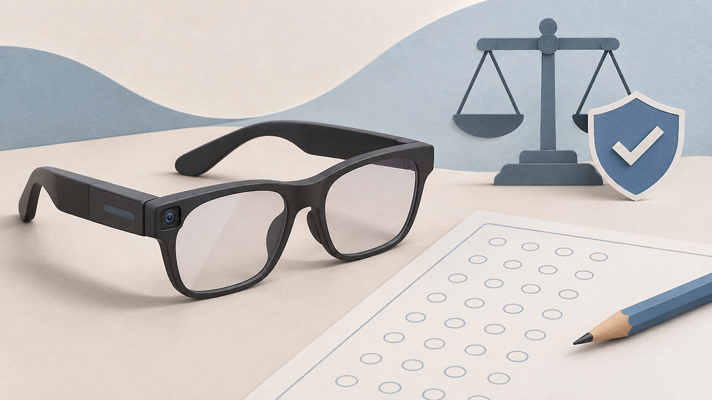

안녕하세요. dev.log입니다.

시험장에 안경을 쓰고 가도 되는지, 단추가 달린 옷도 점검하는지 궁금하다면 응시할 시험의 공고에서 반입 금지 물품과 제출 절차부터 확인하면 됩니다. AI 안경과 초소형 카메라를 이용한 부정행위 우려가 커지면서 정부는 수능 현장 점검을 강화하고 국가자격시험 조사에 나섰습니다. 수능 당일 현장에서 적용한 조치와 법 개정을 추진 중인 대책은 적용 시점이 다릅니다.

최종 확인: 2026년 11월 24일 (한국시간). 후속 발표가 나오면 해당 항목과 글 아래 변경 기록에 발표일과 적용 시점을 함께 적습니다.

## 응시할 시험부터 찾아보세요

아래 표에는 공식 발표에서 확인한 시험별 점검과 준비사항을 담았습니다.

| 시험 | 확인된 검사·대응 | 수험생 준비사항 |
| --- | --- | --- |
| 2027학년도 수능 | 1교시 전 안경을 내려놓고 전수검사하며, 매 교시 착용 안경을 전수점검합니다. 3교시 전 모든 휴대물품을 다시 점검하고 단추에 스티커를 붙이는 조치가 발표됐습니다. | 일반 안경도 확인 대상입니다. 반입 금지 스마트기기는 가져가지 않고, 가져왔다면 정해진 절차로 제출합니다. |
| 2027학년도 인천 중등교사 임용 1차 | 11월 28일 시험에서 매 교시 시작 전에 스마트안경을 가지고 있거나 쓰고 있는지 확인합니다. | 인천교육청 공고에서 반입 금지 물품과 제출 절차를 확인합니다. |
| 국가자격시험 | 스마트기기 반입 금지 안내·감독 강화, 전파탐지기 도입 등을 추진합니다. | 해당 자격과 회차의 주관기관 공지를 확인합니다. 탐지장비 배치는 시험별로 확인해야 합니다. |
| 공무원 채용·어학·기타 시험 | 이번에 대조한 정부 발표만으로 개별 시험의 검사 방식은 확인하지 못했습니다. | 해당 시험의 수험자 유의사항에서 안경 검사, 전자기기 제출, 반입 금지 품목을 확인합니다. |

수능 항목은 [정부의 11월 17일 담화](https://www.korea.kr/news/policyNewsView.do?newsId=148975916), 국가자격시험 항목은 [고용노동부·한국산업인력공단의 11월 16일 발표](https://www.korea.kr/news/policyNewsView.do?newsId=148975783)를 기준으로 작성했습니다. 인천 중등교사 임용 1차 시험은 [인천교육청의 11월 20일 공고](https://www.ice.go.kr/upload/ice/na/bbs_1777/2026/11/d805080018564e09a3351943a3bb70c3.pdf)를 기준으로 정리했습니다.

대구시교육청은 2026학년도 2학기 고등학교 기말고사부터 AI를 활용한 부정행위 방지 대책을 적용합니다. 학교에는 시험 전 전자기기를 걷고 매 교시 안경과 복장을 확인하도록 안내했습니다. 교육청은 시험용 필기구와 금속탐지기를 지원합니다. 탐지기는 부정행위가 의심되는 경우 등에만 비접촉 방식으로 쓰도록 했습니다. [대구시교육청 11월 23일 보도자료](https://www.dge.go.kr/pr/na/ntt/selectNttList.do?bbsId=2680&mi=5279)

교육부는 11월 24일 전국 고등학교의 2학기 기말고사부터 스마트기기 부정행위 대응 방안을 우선 적용한다고 밝혔습니다. 학교는 시험 전에 전자기기를 걷고 매 교시 안경과 복장을 확인합니다. 교육부는 입실 전이나 시험 직후 금속탐지기로 전자기기 무단 소지 여부를 확인할 계획입니다. 중학교는 이 방안을 참고해 시험 감독을 강화합니다. 이미 기말고사가 시작된 일부 학교의 고3 시험에는 별도 안내를 적용합니다. 금속탐지기는 부정행위가 의심되거나 학생이 다시 입실할 때 등에 쓰고, 학교가 필기구를 일괄 지급하기 어려우면 개인 필기구를 허용하되 매 교시 확인합니다. 교육부는 스마트기기를 소지하거나 사용하다 적발되면 당일 모든 과목을 0점 처리하는 방안을 제시하고, 고등학교에는 징계가 최대 퇴학까지 가능하도록 권고할 계획입니다. [교육부 11월 24일 발표](https://www.korea.kr/news/policyNewsView.do?newsId=148976387&pWise=sub&pWiseSub=R1)

AI 안경과 시험 공정성을 표현한 개념 일러스트입니다. 실제 시험장 검사 사진은 아닙니다.

## 수능에서 안경과 단추를 확인하는 이유

2027학년도 수능은 2026년 11월 19일에 치러졌습니다. 정부가 [11월 17일 발표한 담화](https://www.korea.kr/news/policyNewsView.do?newsId=148975916)에는 안경 점검과 단추형 카메라에 대응하기 위한 스티커 조치가 포함됐습니다. 평범한 소지품처럼 보이는 물건에 촬영·통신 기능을 숨길 수 있어, 감독 과정에서 기기 여부를 확인하려는 조치입니다.

일반 안경이나 단추가 달린 옷을 일괄 금지하지는 않습니다. 정부는 장신구 착용을 자제하고 단추 없는 옷을 입도록 권고했습니다. 시력 교정용 안경을 쓰는 수험생도 감독관이 확인을 요청하면 따라야 합니다. 스마트안경에는 반입 금지 물품 규정을 적용합니다.

11월 20일 [교육부 적발 현황](https://www.moe.go.kr/boardCnts/viewRenew.do?boardID=294&boardSeq=107732&lev=0&m=020402&opType=N&page=1&s=moe&searchType=null&statusYN=W)에 따르면, 5교시까지의 추가 보고를 반영한 전자기기 관련 부정행위 집계는 **111건**입니다. 4교시까지의 잠정 집계는 98명이었습니다. 시험 중 스마트기기를 실제 사용해 적발된 사례는 **5건**으로, 이 중 스마트안경 사용은 1건입니다. 적발 집계와 개인별 처분은 별개입니다.

정부는 11월 20일 범정부 대응팀을 출범했습니다. 시험장에서 적발되지 않은 사례도 추가로 조사하고, 부정행위가 의심되는 사례는 수사기관에 넘길 방침입니다. [국무조정실 발표](https://www.opm.go.kr/opm/news/press-release.do?articleNo=164260&mode=view)

[국민권익위 보도자료](https://www.korea.kr/briefing/pressReleaseView.do?newsId=156789970)에 따르면 첨단 전자기기를 이용한 수능 부정행위 집중신고 기간은 **2026년 11월 20일부터 2027년 1월 19일까지**입니다. [청렴포털](https://www.clean.go.kr)에서 신고할 수 있고, 변호사를 통한 비실명 대리신고도 가능합니다. 신고로 응시자격 정지 등 행정처분이 이뤄진 경우 **건당 최대 1억 원**의 포상금 지급을 추진합니다.

## 스마트안경 소지와 사용의 제재 차이

교육부는 [11월 6일 안내](https://www.moe.go.kr/boardCnts/viewRenew.do?boardID=340&boardSeq=107580&lev=0&opType=N&page=1&s=moe)에서 스마트안경을 제출하지 않고 소지한 경우와 시험 중 사용한 경우를 구분했습니다. 시험 중 사용에는 착용도 포함됩니다.

| 수능에서의 상황 | 안내된 제재 |
| --- | --- |
| 1교시 시작 전 제출하지 않은 스마트안경을 소지하다 적발된 경우 | 해당 시험이 무효 처리됩니다. |
| 시험 중 스마트안경을 사용한 경우, 착용 포함 | 해당 시험이 무효 처리되고 다음 해 응시자격도 정지됩니다. |

전원을 꺼 두거나 쓸 계획이 없어도 스마트안경은 가져가지 않는 게 좋습니다. 반입 금지 물품을 가져왔다면 가방에 넣어 두었더라도 1교시 시작 전에 감독관에게 제출해야 합니다.

## ‘10년 응시 제한’은 추진 중인 내용

정부는 [11월 17일 발표](https://www.korea.kr/news/policyNewsView.do?newsId=148975916)에서 수능 부정행위에 대한 응시 제한을 1년에서 10년으로 늘리는 방안을 내놓았습니다. 국회와 협의해 추진하는 방안이며, 이번 수능의 스마트안경 소지·사용에는 앞 표에 나온 제재가 적용됩니다.

법 개정과 시행이 확정되면 적용 대상, 시행일, 경과조치를 이 항목에 추가하겠습니다.

## 국가자격시험은 조사와 종합대책을 병행

고용노동부와 한국산업인력공단은 [11월 16일 발표](https://www.korea.kr/news/policyNewsView.do?newsId=148975783)에서 세무사 시험의 AI 활용 부정행위 의심 사례를 계기로 올해 실시한 국가자격시험을 조사하고, 연내 종합대책을 마련하겠다고 밝혔습니다.

발표에는 제보센터 개설, 스마트기기 반입 금지와 처벌기준 안내 강화, 감독관 교육 및 전담 감독위원 확대, 전파탐지기 도입 추진 등이 포함됐습니다. 전파탐지기는 무선 신호를 살피는 장비입니다. 실제 배치 여부는 시험별로 확인해야 합니다.

고용노동부와 한국산업인력공단은 해당 세무사 시험의 대상자에게 시험 무효, 합격 취소, 5년간 응시 제한, 고발 등의 조치를 신속히 진행하겠다고 밝혔습니다.

고용노동부는 11월 19일 국가기술자격시험 부정행위자의 응시 제한을 현행 3년에서 10년으로 늘리는 방안을 발표했습니다. 수능의 10년 제한과는 별개로 추진 중이며, 시행 시점은 아직 발표되지 않았습니다. [고용노동부 발표](https://www.korea.kr/news/policyNewsView.do?newsId=148976081)

고용노동부와 한국산업인력공단은 즉시 시행할 부정행위 방지 대책을 11월 21일 경비지도사 시험에 처음 적용했습니다. 응시자 11,554명 가운데 태블릿PC·스마트워치 소지, 휴대전화 전원 미차단 등 전자기기 관련 위반이 6건 적발됐습니다. 국가기술자격시험의 응시 제한을 3년에서 10년으로 늘리는 방안은 후속 대책으로 추진 중입니다. [고용노동부 11월 24일 발표](https://www.moel.go.kr/news/enews/report/enewsView.do?news_seq=20295)

## 내가 치르는 시험에서 확인할 항목

아래 세 항목은 응시할 시험의 최신 공고에서 확인하세요. 담당 기관과 적용 규정은 시험마다 다를 수 있습니다.

교육부는 11월 20일 논술·면접 등 대학별고사의 부정행위 대응 방안을 점검하고 긴급 대응체계를 구축한다고 밝혔습니다. [서울여대 입학처](https://admission.swu.ac.kr/bbs/board.php?bo_table=notice&wr_id=29299)는 논술고사에 부득이하게 가져온 전자기기의 전원을 완전히 끄고 감독관 안내에 따라 제출하도록 했습니다. 단추가 많은 옷과 후드티는 착용 자제 권고입니다. 대학마다 안내가 다를 수 있으니 지원 대학 입학처에서 전자기기 제출 방법과 복장 유의사항을 확인하세요. [교육부 대학별고사 발표](https://www.moe.go.kr/boardCnts/viewRenew.do?boardID=294&boardSeq=107745&lev=0&m=020402&opType=N&page=1&s=moe&searchType=null&statusYN=W)

| 확인할 항목 | 공고에서 찾아볼 내용 |
| --- | --- |
| 반입·소지 제한 | 스마트안경, 촬영·녹음·통신기기 등이 포함되는지 확인합니다. |
| 제출·검사 절차 | 제출 시점과 장소, 안경 등 소지품 검사 안내를 확인합니다. |
| 부정행위 제재 | 시험 무효, 합격 취소, 응시 제한의 대상과 기간을 확인합니다. |

새 대책이 나오면 발표일과 함께 어느 시험의 어느 회차에 적용되는지 확인해야 합니다. 이미 치른 시험의 조사인지, 다음 시험의 감독 강화인지, 법 개정 추진인지에 따라 후속 일정을 확인할 곳과 시점이 다릅니다.

## 발표별 변경 기록

| 발표일 | 반영한 내용 | 현재 단계 |
| --- | --- | --- |
| 2026.11.24 | 교육부 고교 내신시험 부정행위 대응 방안 및 고용노동부 국가자격시험 대책 발표 | 고교 2학기 기말고사부터 우선 적용합니다. 11월 21일 경비지도사 시험에서는 전자기기 관련 위반 6건이 적발됐습니다. |
| 2026.11.23 | 대구시교육청, AI 활용 내신 부정행위 방지 대책 발표 | 대구 지역 고등학교의 2학기 기말고사부터 적용합니다. |
| 2026.11.20 | 수능 전자기기 적발 집계, 범정부 대응팀 출범 및 대학별고사 대응 | 5교시까지 111건 적발. 시험 종료 후 추가 조사 진행. 대학별고사 유의사항은 학교별 공지를 확인합니다. |
| 2026.11.20 | 인천 중등교사 임용 1차 시험의 스마트안경 확인 절차 공고 | 11월 28일 인천 시험에 적용합니다. |
| 2026.11.19 | 수능 부정행위 집중신고 안내 및 국가기술자격 제재 강화 방안 | 11월 20일 신고 접수 시작. 조건 충족 시 건당 최대 1억 원 지급 추진. 국가기술자격 응시 제한 3년에서 10년으로 확대 추진. |
| 2026.11.17 | 수능 안경·단추 점검 강화, 응시 제한을 1년에서 10년으로 확대 추진 | 현장 대책과 입법 추진을 구분했습니다. |
| 2026.11.16 | 국가자격시험 조사와 연내 종합대책 예고 | 후속 세부 대책을 기다리고 있습니다. |
| 2026.11.06 | 수능 스마트안경 미제출 소지·사용 제재 안내 | 올해 수능 안내를 반영했습니다. |
