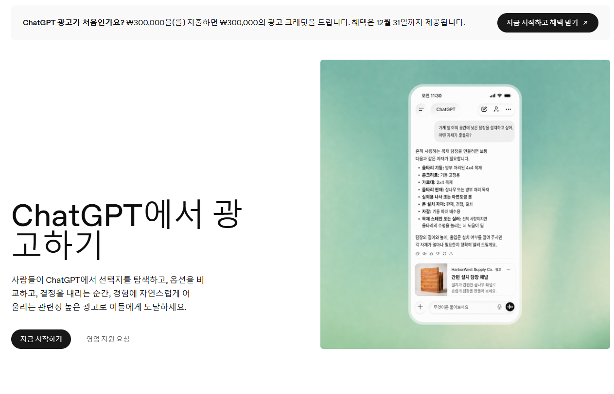
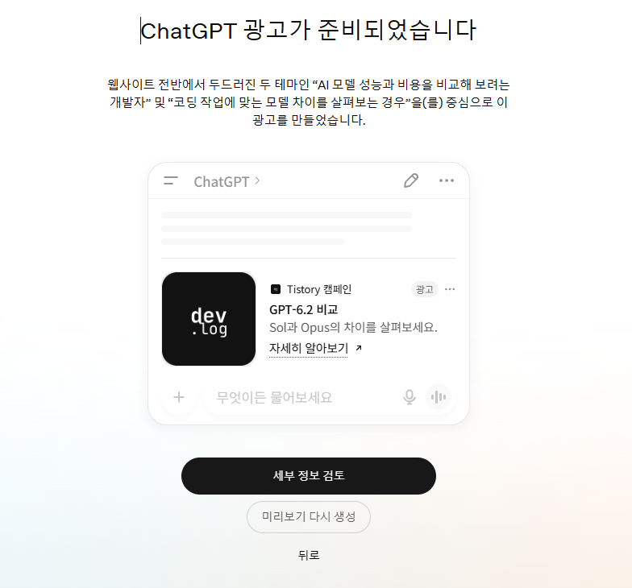
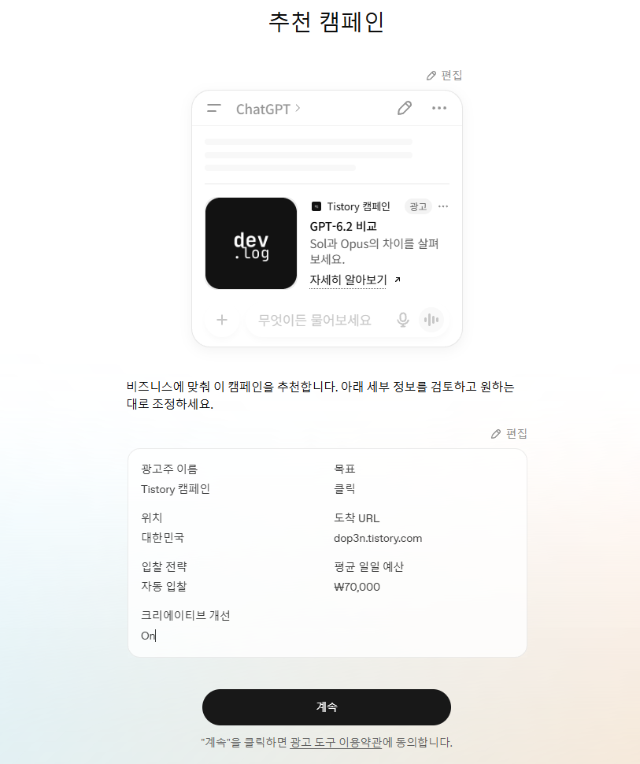
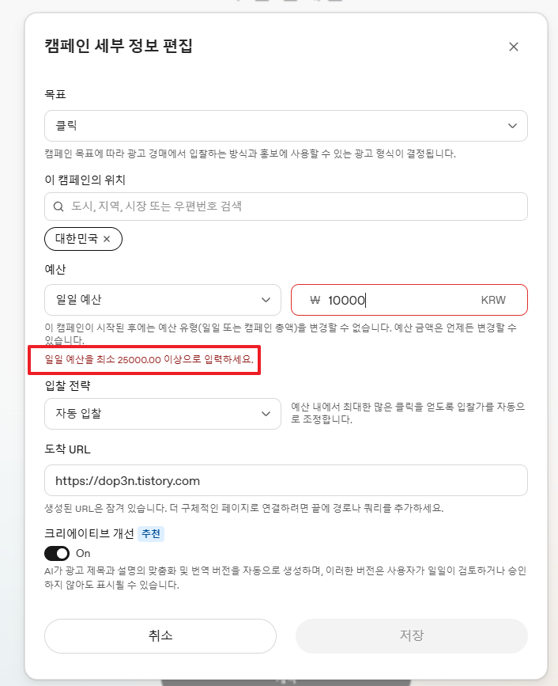
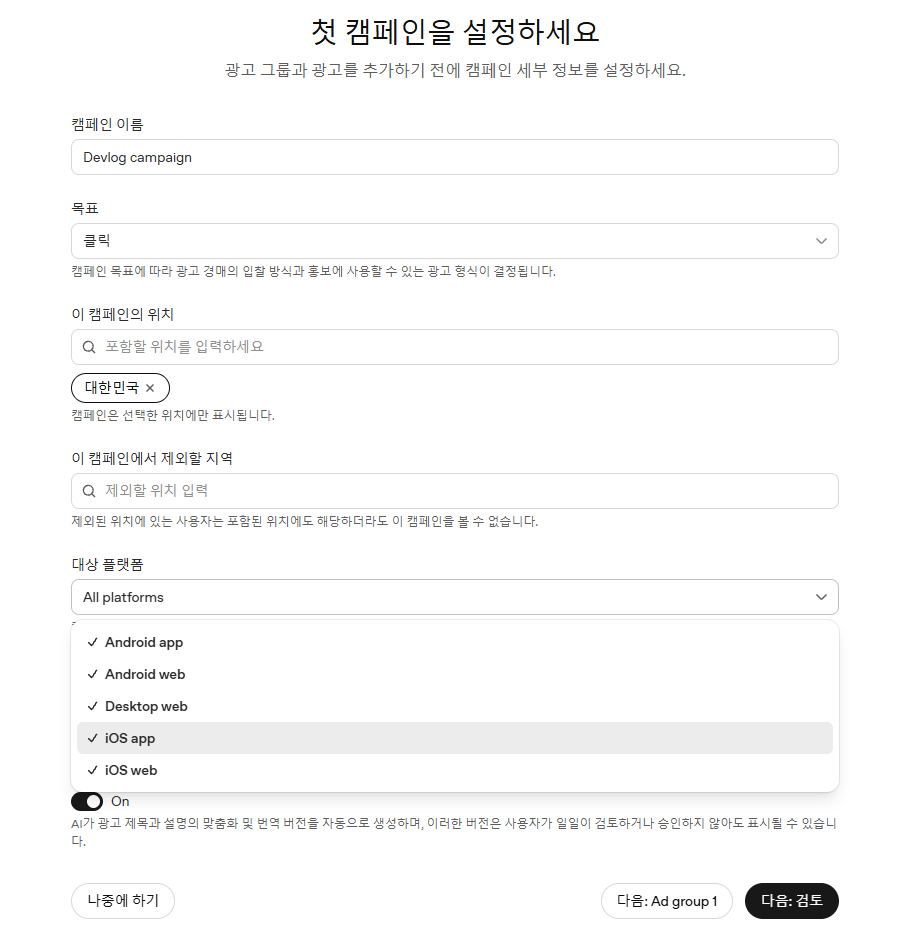

안녕하세요. dev.log입니다.

제 사이트를 ChatGPT에 광고하려면 어디서 시작하고 예산은 얼마부터 잡아야 할까요? 한국에 광고와 청구를 담당할 법인을 둔 광고주는 OpenAI의 Ads Manager 베타에서 직접 캠페인을 설정할 수 있습니다. 저도 dev.log를 홍보하려고 광고 설정 화면을 열어 봤습니다. **제 계정의 일일 예산 입력란에는 최소 25,000원이 표시됐습니다.** 같은 일일 예산으로 7일을 잡으면 175,000원입니다. 설정 화면과 광고 미리보기까지만 살펴봤고, 캠페인 설정을 완료하거나 광고를 집행하지는 않았습니다. [Ads Manager 베타 개요](https://help.openai.com/en/articles/20001206-ads-manager-beta-overview) · [국가별 이용 조건](https://help.openai.com/en/articles/20001245-ads-manager-availability)

### 1. 광고주 페이지에서 시작

[OpenAI 광고주 페이지](https://ads.openai.com/)에서 ‘지금 시작하기’를 찾으면 됩니다. OpenAI는 2026년 5월 5일 발표에서 광고주가 캠페인을 직접 만들고 관리하는 셀프서비스 Ads Manager 베타를 공개했습니다. 2026년 11월 22일(한국시간)에 확인한 도움말에는 한국이 셀프서비스 지원 국가에 포함돼 있습니다. 국가 기준은 실제로 광고를 집행하고 청구를 받는 법인의 소재지입니다. [베타 발표](https://openai.com/index/new-ways-to-buy-chatgpt-ads/) · [국가별 이용 조건](https://help.openai.com/en/articles/20001245-ads-manager-availability)

*광고주 페이지에서 ‘지금 시작하기’를 누르면 광고 설정을 시작할 수 있습니다.*

### 2. 사이트 광고 미리보기

‘ChatGPT 광고가 준비되었습니다’ 화면에는 dev.log의 GPT-6.2 비교 글을 소개하는 광고 미리보기가 나왔습니다. ‘세부 정보 검토’를 열면 캠페인에서 어떤 목표와 예산을 잡았는지 살펴볼 수 있습니다.

*dev.log의 GPT-6.2 비교 글을 소개하는 광고 미리보기입니다.*

### 3. 추천 캠페인에서 목표와 도착 주소 확인

추천 캠페인에는 노출 위치가 한국, 목표가 클릭, 입찰 전략이 자동 입찰로 표시됐습니다. 추천 평균 일일 예산은 70,000원이었습니다. 홍보하려던 사이트 주소가 도착 주소에 들어 있는지 확인한 뒤 예산 편집 화면을 열었습니다.

*추천 캠페인에는 한국, 클릭 목표, 자동 입찰, 평균 일일 예산 70,000원이 표시됐습니다.*

### 4. 일일 예산 입력란에 표시된 최소 25,000원

캠페인 세부 정보 편집 화면에서 원화 일일 예산에 10,000원을 넣자 최소 25,000원을 입력하라는 안내가 나왔습니다. 예산 유형에는 캠페인 총액 옵션도 있었습니다. 화면에서 확인한 일일 예산 하한을 7일에 적용하면 아래와 같습니다.

*일일 예산에 10,000원을 넣자 최소 25,000원을 입력하라는 안내가 나왔습니다.*

| 항목 | 금액 |
| --- | ---: |
| 제 계정에 표시된 일일 예산 하한 | 25,000원 |
| 같은 일일 예산으로 7일을 잡았을 때 | 175,000원 |

OpenAI는 일일 예산을 **광고 계정 시간대 기준 일요일부터 토요일까지의 하루 평균**으로 설명합니다. 실제 일별 지출은 광고가 얼마나 노출되고 클릭되는지 등 캠페인 집행 상황에 따라 달라질 수 있습니다. Ads Manager에서 캠페인을 만들거나 예산을 편집할 때는 적용되는 하루 최대 지출액과 7일 최대 지출액이 함께 표시됩니다. 도움말은 일일 예산 하한이 시장과 통화에 따라 달라진다고 안내합니다. 위의 175,000원은 같은 일일 예산을 7일에 적용한 예시입니다. 캠페인 일정과 실제 청구액은 별도로 확인해야 합니다. [OpenAI 일일 예산 안내](https://help.openai.com/en/articles/20001413-daily-budgets)

### 5. 첫 캠페인에서 지역과 플랫폼 설정

‘첫 캠페인 설정’에서는 노출할 지역과 제외할 지역을 정할 수 있습니다. 대상 플랫폼 목록에는 Android 앱·웹, 데스크톱 웹, iOS 앱·웹이 따로 표시됩니다. 이 화면에서 검토 단계로 넘어가는 버튼은 ‘다음: 검토’입니다.

*첫 캠페인 설정에서 노출 위치와 플랫폼을 고른 뒤 ‘다음: 검토’로 이어집니다.*

### ChatGPT 이용자에게 광고가 표시되는 곳

한국에서 ChatGPT 이용자에게 광고가 나오기 시작한 시점은 OpenAI가 2026년 8월 11일 업데이트에서 공개했습니다. OpenAI의 10월 21일 안내에 따르면 이용자 쪽 광고는 Free와 Go 요금제에 표시됩니다. 광고가 표시될 때는 후원 표시가 붙고, ChatGPT 답변과 시각적으로 구분됩니다. [한국 출시 업데이트](https://openai.com/index/testing-ads-in-chatgpt/) · [노출 요금제 안내](https://openai.com/index/chatgpt-ads-expands-26-new-countries/)
